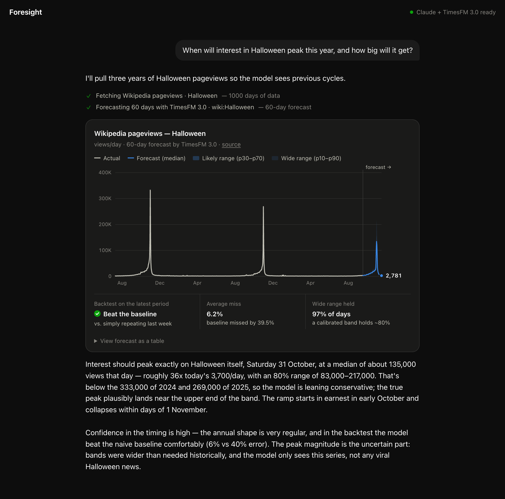

# Foresight

**Ask a question about the future in plain English. Get a real forecast, with an honest score of how far to trust it.**

LLMs are bad at numbers. Forecasting models can't read. Foresight pairs them:

- **Claude** understands the question, decides which public data measures it, fetches that data live, and explains the result.
- **TimesFM 3.0** (Google's time-series foundation model, run locally) produces the forecast and its uncertainty bands, zero-shot.
- Every forecast is **backtested on the spot**: the most recent period is hidden, forecast blind, and scored against a naive "repeat last week" baseline. The agent has to ground its confidence in that result, and the UI shows it under every chart.



Nobody told the forecasting model what Halloween is or when it happens. From raw daily numbers alone it puts the peak on 31 October. Asked about Black Friday it says 27 November, the correct date for 2026, even though last year's peak was on the 28th.

```
"Is interest in ChatGPT still growing?"
   └─ Claude ─→ search_wikipedia ─→ get_wikipedia_pageviews ─→ forecast (TimesFM 3.0)
                                                                  ├─ median + p10–p90 fan chart
                                                                  └─ backtest vs. naive baseline
   └─ "Probably not: flat to slightly down. The model beat the baseline on the last 30 days, so moderate confidence…"
```

## Run it

Needs [uv](https://docs.astral.sh/uv/) and either an [Anthropic API key](https://console.anthropic.com/settings/keys) or an [OpenRouter key](https://openrouter.ai/keys). A question costs about 2–4 cents with Claude Opus 5. No GPU: TimesFM takes ~0.1s per forecast on a laptop CPU.

```bash
cp .env.example .env          # then paste ANTHROPIC_API_KEY or OPEN_ROUTER_KEY into it
uv sync
uv run uvicorn foresight.server:app
```

Open http://localhost:8000. The first start downloads the TimesFM checkpoint (~1 GB) and takes a minute; the dot in the header turns green when it's ready.

Questions can be shared as links: `http://localhost:8000/?q=How+warm+will+Mumbai+be+next+week`

## What it can look at

All sources are free and need no key.

| Source | Good for |
| --- | --- |
| Wikipedia pageviews | public attention on anything with an article |
| npm / PyPI downloads | developer adoption of libraries and AI SDKs |
| CoinGecko | crypto prices (the agent is told these are near random walks, and says so) |
| Open-Meteo | temperature, rain and wind history for any city |

## How it's built

```
foresight/
  series.py      Series + the per-chat store. Tools pass ids around; raw arrays never enter the LLM context.
  sources.py     Live data fetchers → gap-free daily series ending yesterday.
  forecaster.py  TimesFM 3.0 wrapper, quantile bands, and the backtest.
  tools.py       Tool schemas + dispatcher. Failures become error results Claude can recover from.
  llm.py         Claude via the Anthropic API or OpenRouter, same SDK and loop either way.
  agent.py       Streaming tool-use loop (parallel tool calls, rollback on failed turns).
  server.py      FastAPI + server-sent events.
  web/           No-build frontend. Hand-written SVG fan chart with crosshair, table view, dark mode.
tests/           Forecast/backtest maths, source parsing, and the agent loop against a scripted LLM.
```

```bash
uv run pytest
```

## Honest limits

- TimesFM sees only the past of one series. It knows nothing about tomorrow's product launch or news.
- The backtest covers a single recent window. It is a sanity check, not a full evaluation.
- Sessions live in memory; this is a demo, not a multi-user service.

## Licences

Code: MIT. The **TimesFM 3.0 weights are released by Google under a non-commercial licence**, so this project is for research, learning and demos. For commercial use, swap in the Apache-2.0 TimesFM 2.5 checkpoint.
